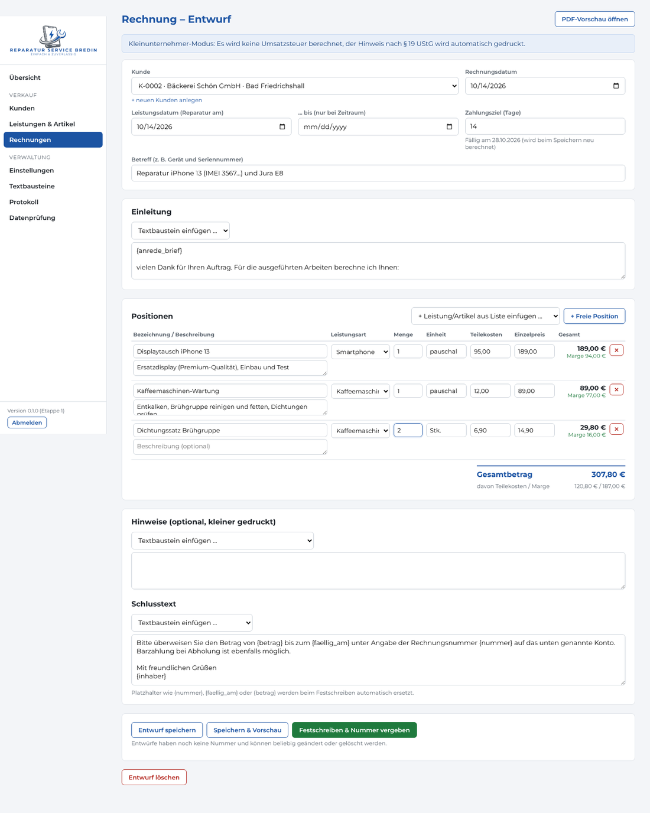
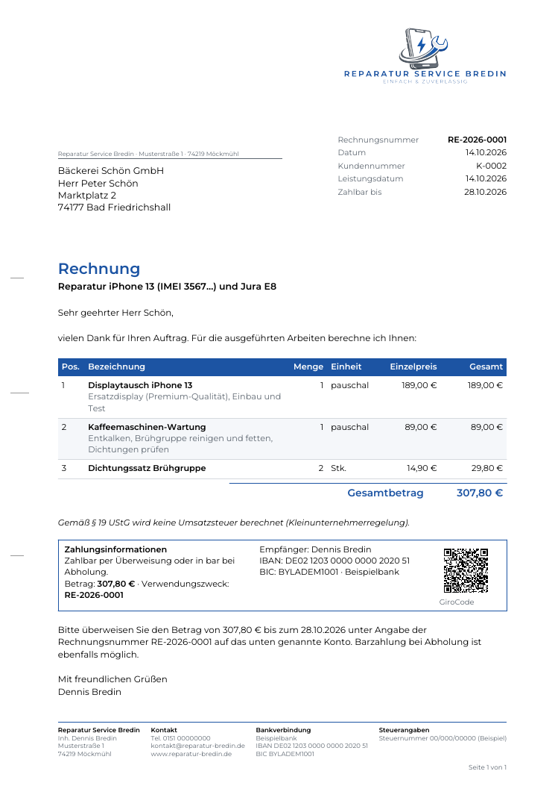
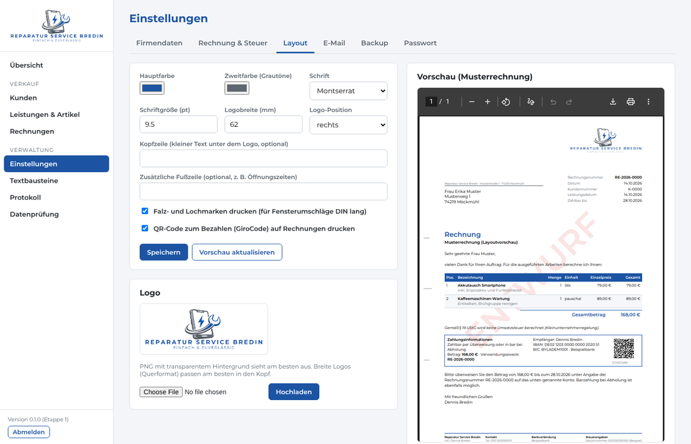
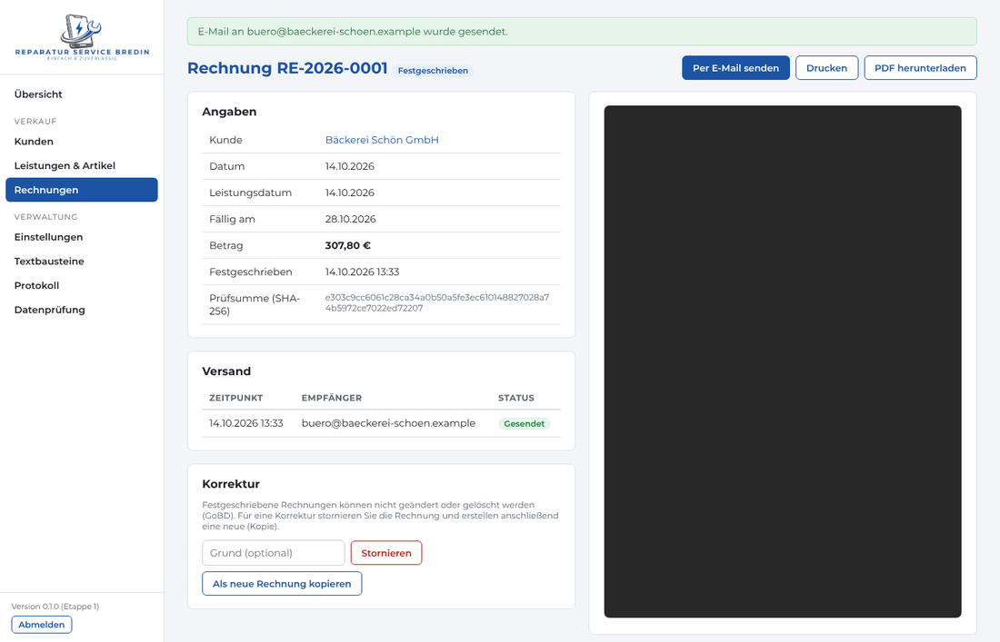

# Reparatur Service Bredin – Buchhaltung & Rechnungen

Eigenes Rechnungs- und Buchhaltungsprogramm für **Reparatur Service Bredin** (Inhaber Dennis Bredin, Möckmühl).
Es läuft lokal auf Ihrem Windows-PC, die Bedienung erfolgt im Browser, und es entstehen **keine laufenden Kosten**.

**Stand:** Reparaturaufträge als Tafel (offen / in Arbeit / erledigt) mit Kostenvoranschlag und automatischem
Rechnungsentwurf, Anfragen aus dem Kontaktformular mit Spam-Erkennung, Kunden, Leistungen/Artikel mit Marge, Rechnungen als PDF mit Logo und GiroCode, Druck,
E-Mail-Versand mit Protokoll, Storno, unveränderbare fortlaufende Nummern, Passwortschutz, tägliches Backup.

| Dokument | Inhalt |
|---|---|
| [docs/ANLEITUNG.md](docs/ANLEITUNG.md) | Bedienung: Rechnung schreiben, Layout & Textbausteine ändern, Backup & Wiederherstellung |
| [docs/RECHT_UND_GOBD.md](docs/RECHT_UND_GOBD.md) | Pflichtangaben, E-Rechnung, Aufbewahrung, GoBD – und ehrlich: wo die Grenzen liegen |
| [docs/ETAPPEN.md](docs/ETAPPEN.md) | Ihre Vorgaben, Technik-Entscheidung und Fahrplan der Etappen |

---

## Installation unter Windows 11 (2 Minuten)

1. Ordner anlegen, z. B. **`C:\RSB-Buchhaltung`**. Bitte nicht unter „Programme“ und nicht in OneDrive,
   denn das Programm muss dort seine Daten und Updates speichern dürfen.
2. **[RSB-Buchhaltung.exe herunterladen](https://github.com/ReparaturServiceBredin/Unternehmen/releases/latest/download/RSB-Buchhaltung.exe)**
   und in diesen Ordner legen.
3. Doppelklick auf **RSB-Buchhaltung.exe**.
   - Beim allerersten Start meldet Windows evtl. „Der Computer wurde durch Windows geschützt“, weil die Datei
     nicht kostenpflichtig signiert ist. Dann auf *Weitere Informationen → Trotzdem ausführen* klicken.
     Das passiert nur einmal, Updates lädt das Programm selbst.
   - Ein schwarzes Fenster öffnet sich (bitte **offen lassen**, Schließen beendet das Programm), und der
     Browser zeigt `http://localhost:5000`.
4. Beim ersten Start ein Passwort festlegen und unter *Einstellungen → Firmendaten* Anschrift, Steuernummer und
   Bankverbindung eintragen.

**Tipps:**
- Rechtsklick auf die EXE → *Senden an → Desktop (Verknüpfung erstellen)*.
- **Mit Windows starten:** `Win + R`, `shell:startup` eingeben und dort eine Verknüpfung zur EXE ablegen.
- Ein Doppelklick auf die EXE, während das Programm schon läuft, öffnet einfach wieder den Browser.

### Updates – automatisch

Das Programm fragt beim Start und alle 6 Stunden nach einer neuen Version. Gibt es eine, passiert Folgendes:
- Beim **nächsten Start** wird sie automatisch installiert. Vorher erstellt das Programm ein Backup,
  danach startet es neu. Abschalten können Sie das unter *Einstellungen → Programm & Updates*.
- Oder Sie klicken in der Oberfläche auf **„Jetzt aktualisieren“**, sobald der Hinweis erscheint.

Ihre Daten bleiben dabei unverändert. Neue Datenbankfelder ergänzt das Programm selbst.
Jede neue Version wird vor der Veröffentlichung automatisch getestet. Die Datei wird beim Herunterladen
mit einer Prüfsumme kontrolliert.

### Umstieg von der bisherigen Installation (start.bat)

1. Altes Programm beenden (schwarzes Fenster schließen).
2. Den Ordner **`Daten`** aus dem alten Programmordner neben die neue `RSB-Buchhaltung.exe` kopieren.
3. EXE starten und mit dem bisherigen Passwort anmelden. Das E-Mail-Passwort muss nicht neu eingegeben
   werden, weil `Daten\geheim` mitkopiert wurde.

Die alte Variante mit `installieren.bat` / `start.bat` funktioniert weiterhin, bekommt aber keine automatischen
Updates.

## Ihre Daten – ein einziger Ordner

Alles liegt im Ordner **`Daten`** direkt neben `RSB-Buchhaltung.exe`:

```
Daten\
  buchhaltung.db      Datenbank (Kunden, Artikel, Rechnungen, Protokoll)
  dokumente\2026\     archivierte Original-PDFs aller festgeschriebenen Rechnungen
  belege\             (ab Etappe 4) Belege zu Ausgaben
  bilder\             Ihr hochgeladenes Logo
  backups\            automatische Backups (ZIP)
  geheim\             Schlüssel für das verschlüsselte E-Mail-Passwort – nicht weitergeben
```

Backups, Wiederherstellung und NAS-Kopie: siehe [docs/ANLEITUNG.md](docs/ANLEITUNG.md#backup-und-wiederherstellung).

## Technik (kurz)

Python 3 · Flask (Weboberfläche) · Waitress (lokaler Webserver) · SQLite (Datenbank in einer Datei) ·
ReportLab (PDF) · cryptography (Verschlüsselung) · PyInstaller (EXE) – alles Open Source und kostenlos.
Die Windows-EXE baut GitHub Actions bei jeder neuen Versionsnummer automatisch, testet sie und veröffentlicht
sie unter *Releases* (`.github/workflows/release.yml`). Neue Version veröffentlichen: `VERSION_NUMMER` in
`rsb/__init__.py` erhöhen und einen Abschnitt in `docs/AENDERUNGEN.md` ergänzen.
Das Programm ist nur vom eigenen PC aus erreichbar (`127.0.0.1`).

## Für Entwickler

```bash
python -m venv .venv && .venv/bin/pip install -r requirements-dev.txt
.venv/bin/python -m pytest              # automatische Tests
RSB_DATEN=Testdaten .venv/bin/python -m rsb.beispieldaten   # Beispieldaten in separatem Ordner
RSB_DATEN=Testdaten .venv/bin/python -m rsb                 # starten
```
Umgebungsvariablen: `RSB_DATEN` (Datenordner), `RSB_HOST`, `RSB_PORT`, `RSB_KEIN_BROWSER=1`.

## So sieht es aus

| Rechnung schreiben (mit Marge je Position) | Fertige Rechnung (PDF) |
|---|---|
|  |  |
| **Layout-Einstellungen mit Vorschau** | **Festgeschrieben & versendet** |
|  |  |

Beispiel-PDF: [docs/Beispielrechnung_RE-2026-0001.pdf](docs/Beispielrechnung_RE-2026-0001.pdf) (mit Beispieldaten).
